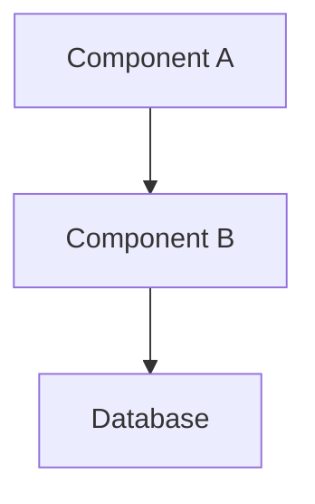

<!--
title: <Architecture Document Title>
status: draft
owner: <team>
created: YYYY-MM-DD
last-updated: YYYY-MM-DD
services: [service1, service2]
-->

# <Architecture Document Title>

## Overview

<!-- 2-4 sentence description of what this document covers and why it exists. -->

TBD

---

## Diagram

<!-- Include a Mermaid or ASCII diagram of the relevant topology or data flow.
     Mermaid is preferred as it renders in GitHub and most docs systems. -->

---

## Detailed Description

<!-- Prose explanation of the diagram. Walk through the flow step by step.
     Explain anything that isn't obvious from the diagram alone. -->

TBD

---

## Key Components

<!-- For each major component in the diagram, describe its role and any non-obvious details. -->

### [Component A]

TBD

### [Component B]

TBD

---

## Design Decisions

<!-- Link to ADRs that record decisions reflected in this architecture. -->

- [ADR-NNNN: Decision title](../adr/ADR-NNNN-title.md) — [one-line summary]

---

## Related Documents

- <!-- Links to service docs, design docs, or other architecture documents -->

## Change Log

| Date | Author | Description |
|---|---|---|
| YYYY-MM-DD | | Initial document |
