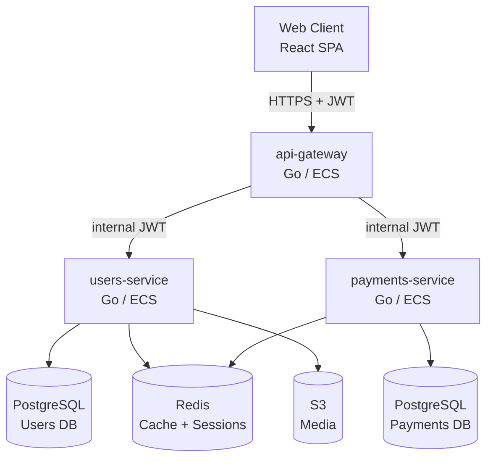

<!--
title: Acme Platform — System Topology Overview
status: current
owner: platform-team
created: 2024-06-01
last-updated: 2024-11-15
services: [all]
-->

# Acme Platform — System Topology Overview

<!--
  TEMPLATE NOTE:
  This is an example for a fictional "Acme Corp" SaaS platform with three services.
  Replace with your actual services, communication patterns, and infrastructure.
  The Mermaid diagram format works well in GitHub and most docs renderers.
-->

## Overview

The Acme platform consists of three backend services and a web client. All services are deployed on AWS ECS Fargate behind an Application Load Balancer. The web client communicates with services over HTTPS using JWT bearer tokens for authentication.

---

## Service Topology

---

## Communication Patterns

### External traffic (client → services)

All external traffic enters through `api-gateway`. The gateway:
1. Verifies the JWT bearer token against the auth public key
2. Extracts the user ID and injects it as an `X-User-ID` header
3. Proxies the request to the appropriate downstream service

Clients never call downstream services directly. This allows `users-service` and `payments-service` to trust the `X-User-ID` header without independently verifying JWTs.

### Internal traffic (service → service)

Service-to-service calls use an internal `X-Internal-Service-Key` header rather than user JWTs. This key is stored in AWS Secrets Manager and injected at container startup. Each service validates the key on internal routes.

**Example:** When a user completes a purchase, `payments-service` calls `users-service POST /internal/users/{id}/credits` to credit the user's account.

### Authentication model

| Caller | Auth method | Header |
|---|---|---|
| Web client | JWT bearer token | `Authorization: Bearer <jwt>` |
| api-gateway → services | Internal service key | `X-Internal-Service-Key: <key>` |
| Services → external APIs | API key per provider | Varies |

---

## Infrastructure

All services run on ECS Fargate in `us-east-1` behind a single Application Load Balancer. Service URLs follow the pattern `api-[service].acme.io`.

| Service | URL | Compute |
|---|---|---|
| api-gateway | `api.acme.io` | ECS Fargate |
| users-service | `api-users.acme.io` | ECS Fargate |
| payments-service | `api-payments.acme.io` | ECS Fargate |

Secrets are stored in AWS Secrets Manager and injected as environment variables at task startup. See `docs/REPO_STATE.md` for the current state of each service's infrastructure.

---

## Key Decisions

- [ADR-0001: JWT authentication via api-gateway](../adr/ADR-0001-example.md) — why auth is centralized in the gateway rather than per-service
- [ADR-0003: PostgreSQL per service, no shared database](../adr/ADR-0003-example.md) — why each service has its own database schema

---

## Related Documents

- [services/api-gateway.md](../services/example-service-overview.md) — api-gateway service overview
- [architecture/data-model.md](./data-model.md) — database schemas and data ownership
- [docs/REPO_STATE.md](../REPO_STATE.md) — current infrastructure state

## Change Log

| Date | Author | Description |
|---|---|---|
| 2024-06-01 | platform-team | Initial topology document |
| 2024-11-15 | platform-team | Updated after ECS migration; removed Cloud Run references |
